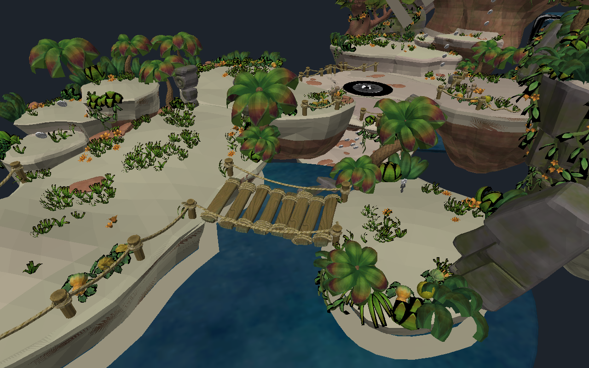
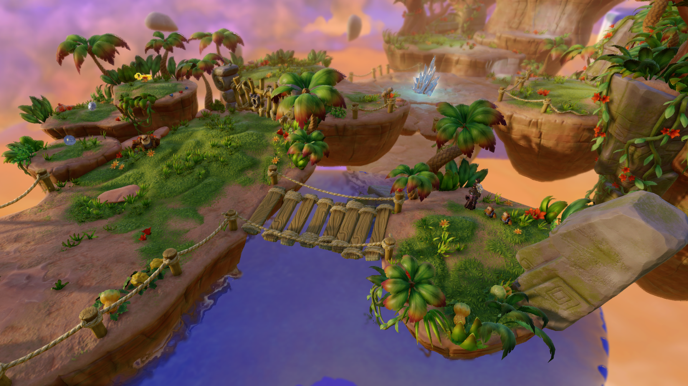
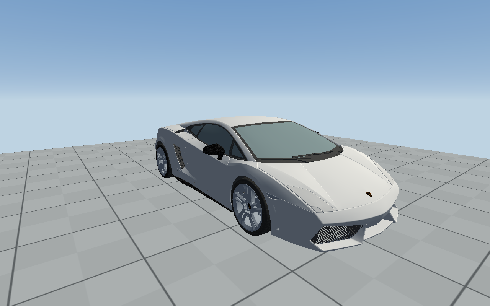
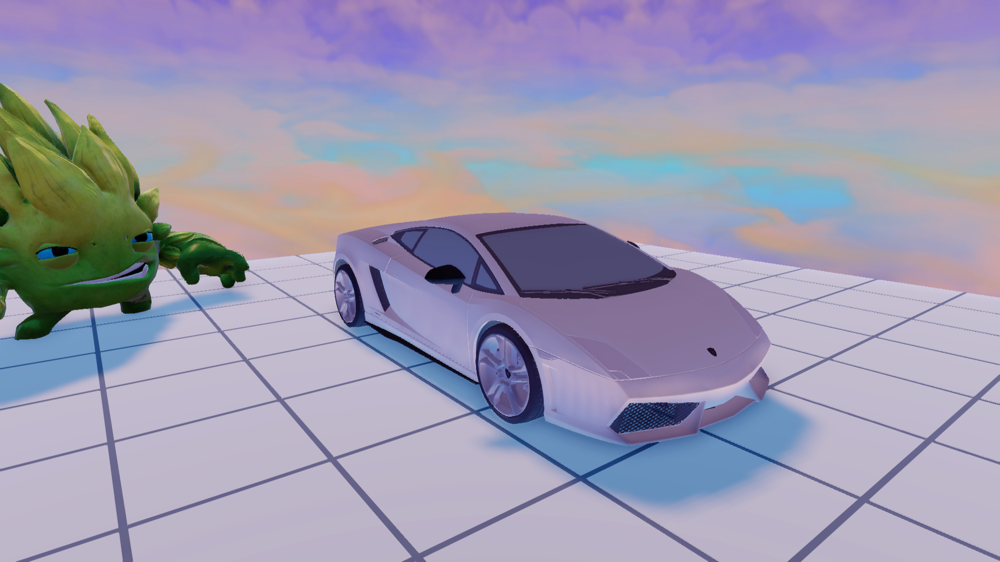
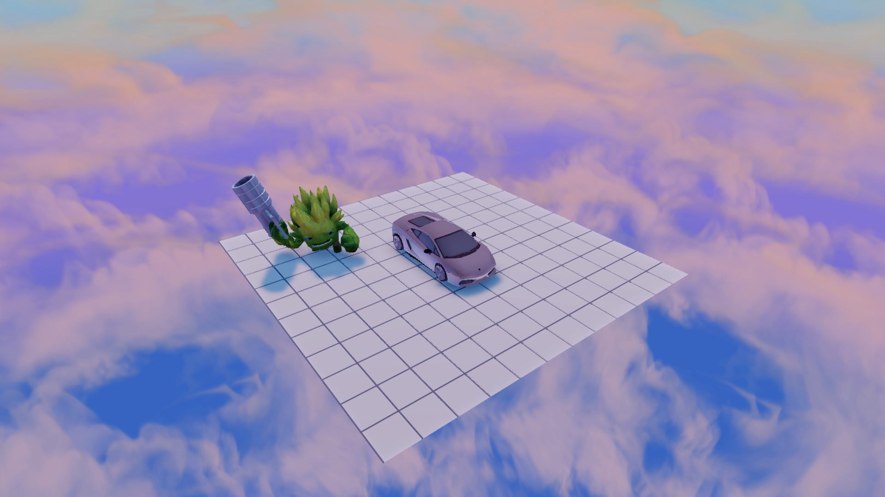

# Viewports

Unedited captures from the Qt/OpenGL editor and the PS4 game running in
shadPS4. Editor overlays and the game HUD are hidden. Freecam moves the game's
camera; it does not rebuild the scene in the editor renderer.

## Know-It-All Island

| Editor | Native freecam |
| :---: | :---: |
|  |  |

The same bridge, from similar viewpoints. Native grass, atmosphere, animated
objects and shading are not all reproduced by the editor.

## Gallardo workshop

| Editor | Native freecam |
| :---: | :---: |
|  |  |

The imported static model on the demo floor. The car is a prop, not a driveable
vehicle. Editor preview lighting and native donor lighting differ.

Raised freecam with the whole playable platform in view. In Live, enable
**Free camera**, move with WASD/Q/E and hold right mouse to look around.
**Hide HUD** removes the game's overlay. [Preview setup](GAME_PREVIEW.md).

Game and vehicle artwork remains third-party content; these screenshots aren't
MIT-licensed assets. [Notices](../THIRD_PARTY_NOTICES.md).
